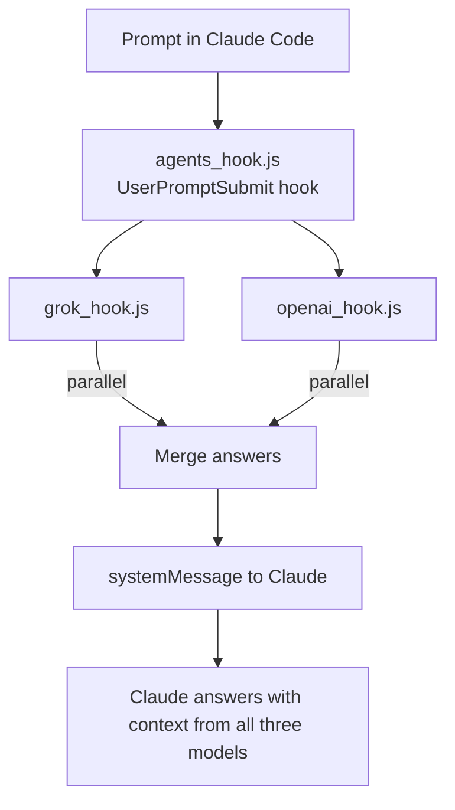

<div align="center">

# Claude Multi-Agent

**Run Claude, ChatGPT and Grok on the same task: Claude orchestrates, the others feed it context in parallel.**


-24C8DB?style=flat-square&logo=tauri&logoColor=white)


</div>

---

## About

Different LLMs notice different things. This project wires ChatGPT and Grok into [Claude Code](https://claude.ai/code) so that every prompt you send to Claude is also answered by the other models in the background, and their answers arrive in Claude's context as a system message. Claude stays the orchestrator and builds on a second and third opinion without you copy-pasting between chat windows. For longer jobs there is a split-terminal mode that runs each agent in its own pane and merges the results.

## ✨ Features

- **Claude Code hook mode**: a `UserPromptSubmit` hook dispatches your prompt to all enabled agents **in parallel** and injects their answers into Claude as a `systemMessage` (with per-agent timeouts so Claude is never blocked).
- **Split-terminal task mode**: opens Windows Terminal panes for Grok, ChatGPT and a Claude collector that waits for both results and combines them.
- **PowerShell launcher** for a Grok + Claude workflow.
- **Per-agent toggles**: enable or disable Grok and ChatGPT individually from the CLI.
- **One-command installer**: `bin/cli.js` copies the scripts into `~/.claude/`, registers the hook in `settings.json` idempotently, checks for API keys, and can cleanly uninstall again.
- **Excel export** (`auto_excel.js`) that turns agent results into a spreadsheet (requires `npm install xlsx`).
- **Desktop GUI (work in progress)**: a Tauri 2 app to toggle agents, manage API keys, check hook status and query Grok/OpenAI directly.

## 🧱 Tech stack

| Area | Technology |
| --- | --- |
| Runtime | Node.js 18+ (CommonJS, no runtime dependencies for the core hooks) |
| Integration | Claude Code `UserPromptSubmit` hooks + `settings.json` |
| Models | OpenAI `gpt-4o-mini`, xAI `grok-3-mini-fast` (via their HTTPS APIs) |
| Terminal orchestration | Windows Terminal split panes, PowerShell, batch scripts, VS Code tasks |
| GUI (WIP) | Tauri 2 (Rust backend) + vanilla HTML/CSS/JS |
| Extras | `xlsx` for the Excel export, optional Python variant of the Grok hook |

## 🏗️ How it works



In **task mode**, `multi_agent_task.js` writes the task to `~/.claude/task_results/`, starts `grok_task_runner.js` and `chatgpt_task_runner.js` in separate panes, and `claude_collector.js` polls for their result files and combines them.

## 🚀 Getting started

**Prerequisites:** [Claude Code](https://claude.ai/code), Node.js 18+, [Windows Terminal](https://aka.ms/terminal) (for split-terminal mode), and API keys from [xAI](https://console.x.ai/) and/or [OpenAI](https://platform.openai.com/).

### 1. Install

```bash
git clone https://github.com/ChristophBarton1/Multi-Agent-for-Terminal-Claude-Open-Ai-Grok.git
cd Multi-Agent-for-Terminal-Claude-Open-Ai-Grok
node bin/cli.js install
```

The installer copies the scripts from `src/` into `~/.claude/` and adds the hook to `~/.claude/settings.json`.

**Manual alternative:** copy the `*.js`, `*.py`, `*.bat` and `*.ps1` files into `%USERPROFILE%\.claude\`, then copy `settings.template.json` to `%USERPROFILE%\.claude\settings.json` and replace `DEIN_USERNAME` in the hook command with your Windows user name.

### 2. Add API keys

Add these environment variables to the `env` block of `~/.claude/settings.json`:

- `XAI_API_KEY`
- `OPENAI_API_KEY`

### 3. Enable agents

```bash
node bin/cli.js agents                 # show status
node bin/cli.js agents grok on         # enable Grok
node bin/cli.js agents chatgpt on      # enable ChatGPT
node bin/cli.js agents grok off        # disable again
```

(Equivalent: `node ~/.claude/agents.js grok on`.)

## 🧭 Usage

**Mode 1: Hook (automatic).** Use Claude Code as usual. On every prompt Grok and ChatGPT are queried in the background; a status message appears while they think.

**Mode 2: Multi-agent task (split terminals).**

```bash
node bin/cli.js task "Analyze my website and suggest improvements"
# or directly
node ~/.claude/multi_agent_task.js "Analyze my website and suggest improvements"
```

**Mode 3: PowerShell launcher (Grok + Claude).**

```powershell
.\launch_agents.ps1 -Task "Your task here"
```

**Test a single agent.**

```bash
node ~/.claude/grok_task_runner.js "What is the best tech stack in 2025?"
node ~/.claude/chatgpt_task_runner.js "What is the best tech stack in 2025?"
```

**Uninstall.**

```bash
node bin/cli.js uninstall
```

**Desktop GUI (WIP)**, requires the [Tauri prerequisites](https://tauri.app/start/prerequisites/) (Rust toolchain):

```bash
cd gui
npm install
npm run tauri dev
```

## 📁 Project structure

| Path | Description |
| --- | --- |
| `bin/cli.js` | Installer / CLI (`install`, `uninstall`, `agents`, `task`) |
| `src/agents_hook.js` | Hook dispatcher: calls all active agents in parallel |
| `src/agents.js` | Enable/disable agents |
| `src/grok_hook.js`, `src/grok_hook.py` | Grok integration for hook mode (JS + Python variant) |
| `src/openai_hook.js` | ChatGPT integration for hook mode |
| `src/grok_task_runner.js`, `src/chatgpt_task_runner.js` | Agents in task / split-terminal mode |
| `src/claude_collector.js`, `src/claude_collector_grok.js` | Wait for agent results and combine them |
| `src/multi_agent_task.js`, `src/start_task.js`, `src/run_full_task.js` | Task launchers |
| `src/launch_agents.ps1`, `src/*.bat` | Windows launchers |
| `src/auto_excel.js` | Excel export of results |
| `src/task_hook.js` | Task hook helpers |
| `settings.template.json` | Claude Code settings template |
| `gui/` | Tauri 2 desktop app (work in progress) |

Root-level copies of the scripts mirror `src/` for the manual install path.

---

<div align="center">

Built by [Christoph Barton](https://christophbarton.com)

</div>
